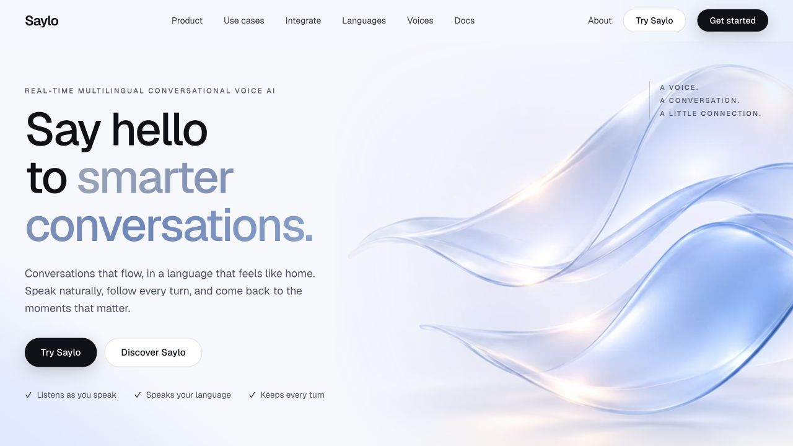
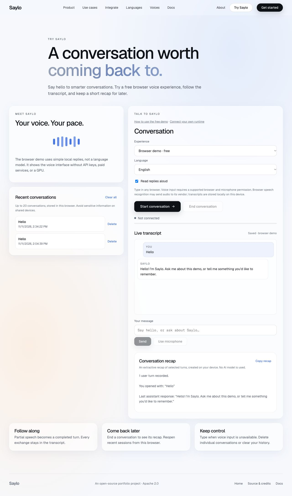

# Saylo

**Say hello to smarter conversations.**

Real-time multilingual conversational voice AI. Run the voice runtime with your own providers and application endpoint, or explore the separate browser demo. Saylo adds live transcripts, local conversation history, and session recaps to an existing open-source voice system.

See the website’s [setup guide](site/setup.html) for browser-demo and original-runtime instructions.

## Try it locally — no keys, installation, or GPU

Requires Node.js 20+:

```sh
npm start
# Open http://localhost:3000
```

Choose **Start conversation** on the demo page. Type a message, or select **Use microphone** in a supported browser. Choose a language before starting. End the conversation for an extractive recap, then reopen it from Recent conversations. Delete individual sessions or clear all history.

The browser demo uses simple localized rules, **not a language model**. Browser speech recognition and synthesis demonstrate the interface; they do not reproduce the original adaptive voice pipeline. Typed input works without speech support. No application API keys, subscriptions, paid credits, GPU, or backend server are required for this path. Browser recognition may use its vendor’s network service and is not guaranteed offline.

## Saylo contributions

- Original icy-blue glass artwork for the hero, phone, globe, sound waves, and four use-case cards; generated specifically for Saylo after visual approval.
- Plain Saylo wordmark, blue wave favicon, original cool-blue accent and refreshed product copy, preserving the original layout and visual foundation.
- Full live transcript using existing runtime `transcript`, `response`, and `state` DataChannel events. Partial user speech updates in place; completed exchanges remain visible. Runtime responses show generated text, which may exceed audio actually played when interrupted.
- Up to 20 recent conversations in browser localStorage, with titles, timestamps, reopening, deletion, clear-all, bounded content and graceful in-memory fallback. No audio, credentials, authentication or database.
- Copyable extractive recaps created locally from selected conversation turns. These are **not AI-generated summaries**; no additional model call or paid dependency was added.
- A separate browser demo with six selectable locales, speech input where supported, text fallback, and optional spoken replies.
- Removed the upstream enterprise lead form, external star-count badge, and hosted analytics script from the portfolio pages.

## Stack and architecture

```text
Free demo: static HTML/CSS/ES modules
  typed input / browser speech recognition → local rule replies → browser speech synthesis
  conversation events → transcript → bounded localStorage history → extractive recap

Preserved runtime: WebRTC WHIP / Twilio → Go media pipeline
  adaptive STT → application agent → Python voice router → streamed audio
  events DataChannel → the same Saylo transcript/history interface
```

The static frontend uses vanilla JavaScript, Geist typography, existing responsive components, and restrained WebGL effects. The original runtime uses Go 1.25+, Pion WebRTC, provider integrations, and a Python/FastAPI Kokoro/Piper/Sarvam voice router. Existing optional ratings endpoints under `site/api` use MongoDB; the free static export excludes them and requires no database.

## Example application endpoint

The [college enquiry sample](demo-agent/README.md) implements the existing agent HTTP contract with fictional facts and no paid dependencies. Run `node demo-agent/server.mjs` to exercise the application side locally. HTTP integration tests cover it.

## Integrate with your application

Saylo handles audio, recognition, turn-taking and speech output. Your application handles business data, tools and replies. You run the infrastructure and supply your own provider credentials; this repository does not provide a managed calling service.

### 1. Run the runtime

The default stack uses Linux Docker Engine/Compose, an NVIDIA GPU available to Docker, and Deepgram, Groq and Sarvam keys. AssemblyAI is an optional fallback. Provider and telephone usage are charged to your accounts. The voice router also supports native CPU mode.

```sh
cp .env.example .env
# Fill in your provider credentials locally.
docker compose up --build
```

This starts the runtime on `:8080`, voice router on `:8300`, and quickstart page/agent on `:8400`/`:9101`. For macOS and the voice router, see the website [setup guide](site/setup.html) and [voice router setup](voice-router/README.md). The default container setup uses an NVIDIA GPU.

### 2. Point it at your app

Edit the existing section in [runtime configuration](configs/saylo.toml), keeping `[llm] provider = "agent"`:

```toml
[agent]
url = "https://your-app.example.com/voice/agent"
timeout_ms = 60000
```

Set `STREAMCORE_AGENT_API_KEY` on the runtime and validate the corresponding `Authorization: Bearer` header in your application. Restart the runtime after config changes. Use an endpoint reachable from the runtime's network. The browser connects to the runtime; it does not receive your provider keys or call your business endpoint directly.

### 3. Handle the conversation

| Request type | Your application returns |
| --- | --- |
| `listen` | `{}` or a known caller language/region |
| `greeting` | Opening text when the caller stays silent |
| `chat` | Reply text, optionally `end_call` |
| `oneshot` | Background output; `{ "text": "" }` is supported |

For example, a `chat` request contains `session_id`, `text`, and `language`. Your app can look up its opening hours and return `{ "text": "[lang:en] The office opens at 9 AM." }`. Match the language to the router's current capabilities and tag each sentence. The [full agent contract](docs/saylo/agent-contract.md) covers interruption metadata, replaced turns and streaming replies. The [included sample application](demo-agent/README.md) provides a concrete endpoint; the [original quickstart agent](quickstart/README.md) provides model-backed replies with your credentials.

Run `npm start`, open `http://localhost:3000/try.html?mode=server`, enter your runtime's address, and select **Start conversation**. The runtime's events populate the transcript and local history. Remote browser sessions need a reachable HTTPS runtime and working ICE/NAT/TURN configuration.

### Telephone calls

The Twilio Media Streams integration connects phone audio to the same runtime. Configure your own Twilio account/number, `TWILIO_AUTH_TOKEN`, and a public WSS `/twilio/media` endpoint. Your Twilio call flow supplies the stream TwiML. See the website's [setup guide](site/setup.html#phone-calls) for examples.

## Checks

```sh
npm test
npm run check
npm run build
```

```sh
go build ./...
go vet ./...
go test -race ./...
```

## Static site

Import the repository into Vercel with the repository root as the Root Directory. `vercel.json` runs `npm run build` and publishes `dist/`. The website does not need provider keys. Do not set the Root Directory to `site/`.

The Go runtime and Python voice router stay self-hosted. This site does not start them. Other static hosts can serve `dist/` at the root of an HTTPS domain.

## Screenshots





## License

Apache License 2.0. See [LICENSE](LICENSE) and [NOTICE](NOTICE). The voice runtime is built on [StreamCore](https://github.com/streamcoreai/streamcore-server).
